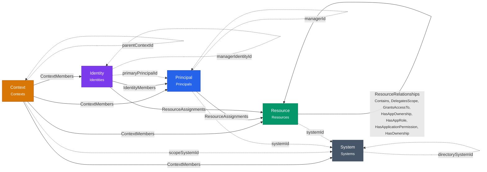
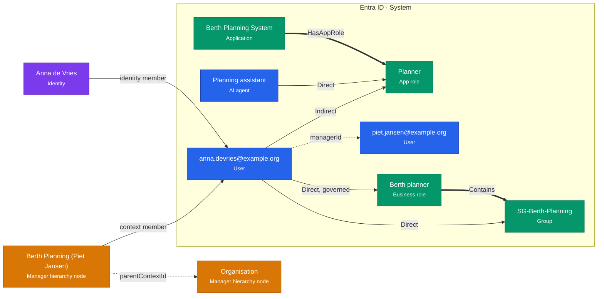

# The Ontology, Visually

Identity Atlas keeps its data in PostgreSQL tables. The **ontology** describes what that data
*means*: which kinds of things exist (an account, a group, a person, a team), how they may be
connected, and which values a field may hold. It is the grammar of the data model, written in a
standard format that other tools can read.

This page shows what that looks like: first the overall picture, then one small team as real data,
then a few lines of the schema file itself.

!!! tip "Download the schema file"
    The ontology is one file, **[`core.ttl`](https://raw.githubusercontent.com/Fortigi/IdentityAtlas/main/ontology/core.ttl)**
    ([view on GitHub](https://github.com/Fortigi/IdentityAtlas/blob/main/ontology/core.ttl)). It is
    written in **Turtle**, the readable text format for RDF, and uses the **OWL 2** vocabulary for
    classes and properties. Protégé, WebVOWL, Apache Jena, rdflib and any other RDF/OWL tool can open
    it; see [Open it in a tool](#open-it-in-a-tool).

    The worked example on this page is a file too:
    **[`examples/team.ttl`](https://raw.githubusercontent.com/Fortigi/IdentityAtlas/main/ontology/examples/team.ttl)**.

---

## The big picture

Everything in Identity Atlas is one of five kinds of **node**, connected by five kinds of **edge**.
A solid arrow is an edge table: a row in it connects two nodes, and carries fields of its own (an
assignment has an `assignmentType`, for example). A dotted arrow is a plain reference from one node
to another (a column such as `managerId`).

<!-- BEGIN GENERATED: ontology core-overview -->

<!-- END GENERATED: ontology core-overview -->

| Node | What it is |
|---|---|
| **System** | A source the data came from: Entra ID, Omada, a SQL database, a CSV file. |
| **Principal** | An *account* in one system: a user, a service principal, a managed identity, an AI agent, a guest. |
| **Resource** | Anything that gives access: a group, an app role, a directory role, a permission — and also a business role. |
| **Identity** | A real *person*, who may have accounts in several systems. |
| **Context** | A grouping of one kind of node: a team, a department, an OU, a tag, a cluster. Contexts form trees. |

Each kind has **types** below it. A Principal is a `User`, an `AIAgent`, a `ServicePrincipal` …; a
Resource is a `Group`, an `AppRole`, a `BusinessRole` …; a Context is a `ManagerHierarchy` node, a
`Department`, a `Tag` …. The full type tree is drawn on the [Core Model Reference](../reference/core-model.md).

---

## One team, as data

The picture below is a small, fictional team: Anna works for Piet. Anna has an account in Entra ID,
holds a business role, and through a group has access to an app role. An AI agent holds that same app
role directly. The manager-hierarchy plugin has put Anna in Piet's team.

<!-- BEGIN GENERATED: ontology example-team -->

<!-- END GENERATED: ontology example-team -->

How to read it:

- **Colour = kind of node**: purple a person (Identity), blue an account (Principal), green something
  that gives access (Resource), orange a grouping (Context). The grey box is the system the accounts
  and resources come from. The small text under each name is its **type**.
- **A solid arrow labelled `Direct` / `Indirect`** is an assignment: who holds what, and how. Anna holds
  the business role *Direct* and *governed* (an approved request); she has the app role *Indirect*,
  because it comes through her group.
- **A thick arrow** is a relationship between two resources: the business role `Contains` the group,
  the application `HasAppRole` the app role.
- **A dotted arrow** is a reference: Anna's account names Piet's as its `managerId`; Piet's team sits
  below the organisation root (`parentContextId`).
- **Anna (the person) and anna.devries@example.org (the account) are two different things.** The
  person can have more accounts in other systems; the `identity member` arrow links them.
- **The team does not point at Piet.** The manager-hierarchy plugin records a team's manager only in
  the team's `externalId` field — there is no manager link. This is one of the facts the ontology
  makes explicit; see [Contexts and the manager hierarchy](../architecture/core-ontology.md#contexts-and-the-manager-hierarchy-as-implemented).

### The same team, as the file says it

This is the complete example file. Every word after `ia:` is a term from the ontology. Each block
describes one thing: its type after `a`, then its fields.

```turtle
--8<-- "ontology/examples/team.ttl"
```

---

## What the schema file says

The ontology itself is written the same way, but it describes the *kinds* of things instead of the
things. A few excerpts, quoted straight from `core.ttl`:

**A kind of node.** `ia:Principal` is a class. It is stored in the `Principals` table, and its
`principalType` column says which subtype a row is:

```turtle
--8<-- "ontology/core.ttl:principal"
```

**A type below it.** An AI agent is a Principal whose `principalType` is `AIAgent`:

```turtle
--8<-- "ontology/core.ttl:ai-agent"
```

**A context type**, with the plugin that makes it and the kind of node it groups:

```turtle
--8<-- "ontology/core.ttl:manager-hierarchy"
```

**A relationship type** between two resources, and which classes it connects:

```turtle
--8<-- "ontology/core.ttl:has-app-role"
```

**A closed list of values.** An assignment is always one of exactly three:

```turtle
--8<-- "ontology/core.ttl:assignment-type"
```

Every term carries a label and a description; the [Core Model Reference](../reference/core-model.md)
lists them all as tables, generated from this same file.

---

## How it stays true

A description is only useful if it matches the application. Three things keep it that way:

- **CI compares the ontology with the code.** If a developer adds a relationship type, a principal
  type, a column, a context type or an allowed value without describing it, the build fails. It also
  fails the other way round, when the ontology describes something the code does not do.
- **CI compares it with the database.** A database migrated from scratch must have exactly the
  columns and allowed values the ontology describes.
- **The pictures on this page and the reference page are generated** from the ontology, and the
  example file is validated against it. Nobody draws them by hand, so they cannot drift.

The details, and what is deliberately *not* checked, are on [Core Ontology](../architecture/core-ontology.md).
How to change the model: [Maintaining the Core Ontology](../contributing/maintaining-the-ontology.md).

---

## Open it in a tool

- **Protégé** (free desktop editor, [protege.stanford.edu](https://protege.stanford.edu/)): *File →
  Open from URL*, paste the `core.ttl` link above. The *Entities* tab shows the class tree (Node →
  Principal → AIAgent …) and every property with its domain and range. The *OntoGraf* tab draws it.
- **WebVOWL** (in the browser, [service.tib.eu/webvowl](https://service.tib.eu/webvowl/)): download
  `core.ttl`, then *Ontology → Select ontology file* to see an interactive graph of the classes.
- **Python** (rdflib):

    ```python
    from rdflib import Graph
    g = Graph().parse("https://raw.githubusercontent.com/Fortigi/IdentityAtlas/main/ontology/core.ttl")
    for cls in g.query("""
        PREFIX ia: <https://identityatlas.io/ontology#>
        PREFIX rdfs: <http://www.w3.org/2000/01/rdf-schema#>
        SELECT ?type WHERE { ?c rdfs:subClassOf ia:Principal ; ia:typeValue ?type }"""):
        print(cls.type)          # User, ServicePrincipal, AIAgent, …
    ```

The namespace `https://identityatlas.io/ontology#` is an identifier, not a web page: opening it in a
browser does not return the file. Use the download links above.
